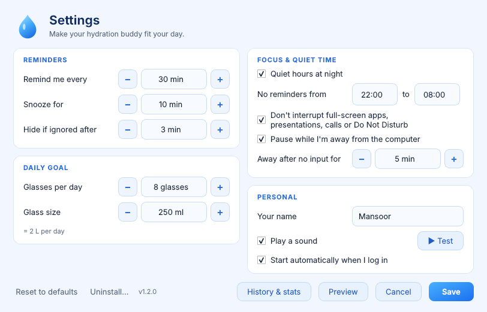
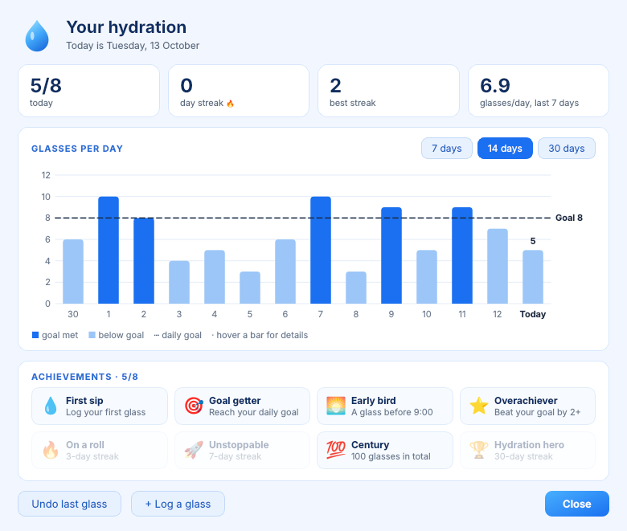

# 💧 Water Reminder

An animated hydration buddy for **Windows, macOS and Linux**. Every 30 minutes, a water drop swims onto your screen holding a glass of water, and a wave rises along the bottom of the screen. Click **I drank a glass** to log it, or snooze it.


## Features

- 🫧 An animated mascot that moves around your screen. Its eyes follow your mouse, and it pauses when you hover over it.
- 🤫 **It won't interrupt you.** It waits while a full-screen app, presentation or call is running, or Do Not Disturb is on, and appears once you're free.
- 🚶 **It pauses while you're away.** The countdown stops when you leave the computer. After a long break, it greets you with a "welcome back" reminder.
- 📊 **History & stats** with a chart of glasses per day, your current and best streaks, a 7-day average and 8 achievements to unlock
- 🥤 A daily goal tracker, a celebration each time you log a glass, and undo if you clicked by mistake
- ⚙️ A **Settings window** for the interval, goal, glass size, quiet hours, focus/away behaviour, name, sound and start-at-login
- 🧭 A system tray / menu bar icon with Remind me now, Log a glass, History & stats, Pause and Settings
- 🪶 Low CPU use: it only animates while the reminder is on screen, and lowers its frame rate while the mascot moves slowly

| Settings | History & stats |
|---|---|
|  |  |

## Download (easiest)

Get the file for your system from the **[latest release](https://github.com/mhd-mansoor/water-reminder/releases/latest)**. You don't need Python.

| System | File | First launch |
|---|---|---|
| **Windows 10/11** | `WaterReminder-Windows.exe` | Double-click it. If Windows shows *"Windows protected your PC"*, click **More info → Run anyway**. |
| **macOS 12+** (Apple Silicon) | `WaterReminder-macOS.dmg` | Open the .dmg and drag **Water Reminder** to **Applications**. The first time, **right-click the app → Open → Open**. |
| **Linux** (x86-64) | `WaterReminder-Linux-x86_64` | `chmod +x WaterReminder-Linux-x86_64 && ./WaterReminder-Linux-x86_64` |

The first time it runs, it installs itself for your user, turns on start-at-login and says hello. To update, download the new version and open it the same way.

> The apps aren't code-signed (signing costs money), which is why Windows and macOS warn you the first time.

## Install from source (alternative)

You need Python 3.9 or newer. Download the project (**Code → Download ZIP**, or `git clone https://github.com/mhd-mansoor/water-reminder.git`), then:

- **Windows:** double-click `install.bat`
- **macOS / Linux:** `bash install.sh`

## Using it

- **The water-drop icon** in the system tray (Windows/Linux) or menu bar (macOS) has Remind me now, Log a glass, Undo, History & stats, Pause for 1 hour, Settings and Quit. Double-click the icon to open stats.
- **In the reminder**, the ⚙ gear opens Settings, the × skips this reminder, and clicking the mascot makes it hop.
- **Opening the app again** while it's already running opens Settings.
- **Windows Start menu:** *Water Reminder*, *Water Reminder Settings* and *Water Reminder Stats*
- **Linux:** the same three entries are in your app menu. You can also use the terminal commands:

| Command | What it does |
|---|---|
| `water-reminder --now` | Show the reminder right now |
| `water-reminder --settings` | Open Settings |
| `water-reminder --stats` | Open History & stats |
| `water-reminder --status` | Print today's progress and your streak |
| `water-reminder --stop` | Stop until next login |

## Settings

| Setting | Default |
|---|---|
| Remind me every | 30 min |
| Snooze for / hide if ignored after | 10 min / 3 min |
| Glasses per day / glass size | 8 × 250 ml |
| Quiet hours | 22:00 – 08:00 |
| Don't interrupt full-screen apps, presentations, calls, Do Not Disturb | on |
| Pause while I'm away (no input for…) | on, 5 min |
| Your name, sound, start at login | login name, on, on |

Changes apply right away. They're saved in `config.json`:
`%APPDATA%\WaterReminder\` (Windows), `~/Library/Application Support/WaterReminder/` (macOS), `~/.config/water-reminder/` (Linux).

### How "busy" and "away" are detected

| | Busy (reminder waits) | Away (countdown pauses) |
|---|---|---|
| **Windows** | Full-screen app or game, presentation mode, microphone or camera in use | No keyboard/mouse input |
| **macOS** | A full-screen app is in front | No keyboard/mouse input |
| **Linux** | Do Not Disturb (GNOME), microphone in use (PulseAudio/PipeWire), full-screen window (X11) | No input (GNOME, or any X11 desktop) |

If something can't be detected on your system, reminders work normally.

## Uninstall

Open **Settings → Uninstall…**. On macOS, also drag the app from Applications to the Trash.
If you installed from source, you can instead run `uninstall.bat` or `bash uninstall.sh`. Add `--purge` to also delete your history.

## For maintainers: publishing a release

The workflow in `.github/workflows/release.yml` builds all three apps on GitHub's machines whenever you push. To publish a version, update `APP_VERSION` in `water_reminder.py`, then:

```bash
git tag v1.2.0
git push origin v1.2.0
```

After about 10 minutes, the files appear on the **Releases** page. You can build locally with `python packaging/build.py`.

## How it works

It's a single Python file, `water_reminder.py`, built with [PySide6 (Qt)](https://doc.qt.io/qtforpython/). The mascot lives in a small transparent, always-on-top window that moves across the screen. The wave is a separate strip that lets clicks pass through it. Everything is drawn in code, including the icons.

Start-at-login uses each system's normal mechanism:

- **Windows:** a `Run` registry entry for your user
- **macOS:** a LaunchAgent
- **Linux:** an XDG autostart entry

The packaged apps are built with PyInstaller.

## License

MIT
